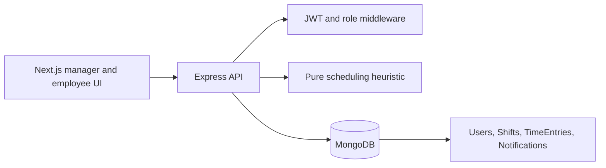

# Architecture

The browser calls lib/api.ts and stores its bearer token in localStorage. The Express app groups routes by auth, employees, shifts, schedule, payroll, reports, notifications and dashboard. Models and controllers handle database writes; recommendation.js is a separate pure scoring/generation module.

Generating a schedule and publishing it are distinct operations. Review the proposal before publishing, since publication can persist assignments and notify employees. Payroll/report calculations are application estimates, not payment processing or statutory payroll certification.
